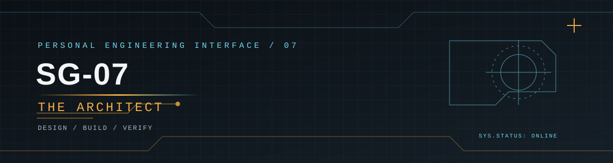

<!-- SG-07 / THE ARCHITECT. Replace all TODO placeholders before publishing. -->

  

<strong>SOFTWARE ENGINEERING · APPLIED AI · SYSTEMS</strong> Building practical software and exploring how reliable systems fit together.

  <a href="https://github.com/sarveshghodke-7">GitHub</a> ·
  <a href="TODO_PORTFOLIO_URL">Portfolio</a> ·
  <a href="TODO_LINKEDIN_URL">LinkedIn</a>

---

## `01 / OPERATOR PROFILE`

I'm Sarvesh Ghodke, a computer science student interested in software engineering, data science, and building useful products.

- **Currently building:** personal portfolio and practical software projects.
- **Interested in:** full-stack development, applied AI/ML, backend systems, and software fundamentals.
- **Approach:** build, test, document, iterate.
- **Education:** B.Tech in Computer Science and Engineering at MGM University, alongside the BS in Data Science and Applications from IIT Madras.

> Mission: turn ideas into software that is useful, understandable, and maintainable.

## `02 / SELECTED BUILDS`

### CareerLens
Resume-oriented project exploring NLP, OCR, and AI-assisted resume generation.
- **Stack:** Python, Flask, spaCy, Tesseract OCR, MySQL, Gemini API.
- **Status:** project prototype; not currently presented as a deployed service.
- **Repository:** [Add repository link](TODO_CAREERLENS_REPO_URL)

### Krishi App
Agriculture-focused mobile application built with a team, with features including weather information, fertilizer calculation, localization, and Firebase integration.
- **Stack:** Flutter, Dart, Firebase.
- **Repository:** [Add repository link](TODO_KRISHI_REPO_URL)

### SG-07 / THE ARCHITECT
A personal portfolio designed as a tactical engineering interface, combining a dark technical visual identity with interactive sections and a simulated in-memory terminal.
- **Stack:** React, TypeScript, Vite, GSAP, Motion.
- **Repository:** [Add repository link](TODO_PORTFOLIO_REPO_URL)
- **Live site:** [Add deployed portfolio URL](TODO_PORTFOLIO_URL)

## `03 / TECHNICAL ARSENAL`

**Languages** · Python · C · Java · JavaScript · C++  
**Frontend & mobile** · HTML · CSS · React · TypeScript · Flutter  
**Backend & data** · Flask · MySQL · PostgreSQL · Firebase · NumPy · Pandas · Matplotlib  
**Tools & workflow** · Git · GitHub · Linux · VS Code

*This is a working list, not a claim of equal proficiency across every tool. Update it as your experience changes.*

## `04 / ENGINEERING RECORD`

- **Winner — Best Solution Award**, National Level Techathon 3.0, Agritech Solutions domain.
- **2nd Runner-Up**, Hack The Gap 2.0.
- **Technical Head**, Google Developer Groups on Campus, MGM University.

Add links to official result pages or event posts where available. Keep the wording aligned with the certificate or organizer announcement.

## `05 / GITHUB TELEMETRY`

  
  

  

  

Stats cards are generated by external services and may occasionally be unavailable. Language cards estimate language share from repository contents; they do not measure proficiency. Contribution activity reflects GitHub activity, not overall engineering ability.

## `06 / CONTACT`

- **Portfolio:** [TODO_PORTFOLIO_URL](TODO_PORTFOLIO_URL)
- **LinkedIn:** [Connect with me](TODO_LINKEDIN_URL)
- **Email:** [TODO_PUBLIC_EMAIL]

SG-07 // THE ARCHITECT · BUILD WITH INTENT.

