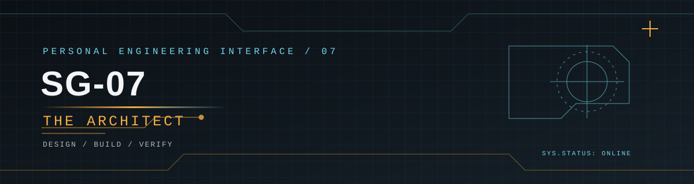

<!-- SG-07 / THE ARCHITECT. Replace all TODO_ placeholders before publishing. -->

  

  

<strong>SOFTWARE ENGINEERING · APPLIED AI · SYSTEMS</strong> Building practical software and exploring how reliable systems fit together.

  
  
  

I'm **Sarvesh Ghodke**, a computer science student interested in software engineering, data science, and building useful products.

| | |
|---|---|
| 🛠 **Currently building** | Personal portfolio and practical software projects |
| 🎯 **Interested in** | Full-stack development · applied AI/ML · backend systems · software fundamentals |
| 🔁 **Approach** | Build → test → document → iterate |
| 🎓 **Education** | B.Tech in Computer Science and Engineering, MGM University, alongside the BS in Data Science and Applications at IIT Madras |

> **MISSION //** turn ideas into software that is useful, understandable, and maintainable.

<table>
<tr>
<td width="33%" valign="top">

#### 🔎 CareerLens
`PROTOTYPE`

Resume-oriented project exploring NLP, OCR, and AI-assisted resume generation. Not currently presented as a deployed service.

     

[**› View repository**](TODO_CAREERLENS_REPO_URL)

</td>
<td width="33%" valign="top">

#### 🌾 Krishi App
`TEAM BUILD`

Agriculture-focused mobile app built with a team: weather information, fertilizer calculation, localization, and Firebase integration.

  

[**› View repository**](TODO_KRISHI_REPO_URL)

</td>
<td width="33%" valign="top">

#### 🧭 SG-07 / THE ARCHITECT
`PORTFOLIO`

A personal portfolio designed as a tactical engineering interface: dark technical visual identity, interactive sections, and a simulated in-memory terminal.

    

[**› Repository**](TODO_PORTFOLIO_REPO_URL) · [**Live site**](TODO_PORTFOLIO_URL)

</td>
</tr>
</table>

**`LANGUAGES`**
     

**`FRONTEND & MOBILE`**
    

**`BACKEND & DATA`**
      

**`TOOLS & WORKFLOW`**
   

<em>A working list, not a claim of equal proficiency across every tool.</em>

| Result | Event / Role |
|---|---|
| 🏆 **Winner — Best Solution Award** | National Level Techathon 3.0 · Agritech Solutions domain |
| 🥉 **2nd Runner-Up** | Hack The Gap 2.0 |
| 🧩 **Technical Head** | Google Developer Groups on Campus, MGM University |

<!-- TODO: link each row to its official result page or event post; keep wording aligned with the certificate or organizer announcement. -->

  
  

  

  

Stats cards come from external services and may occasionally be unavailable. Language cards estimate language share from repository contents; they do not measure proficiency. Contribution activity reflects GitHub activity, not overall engineering ability.

  
  
  

